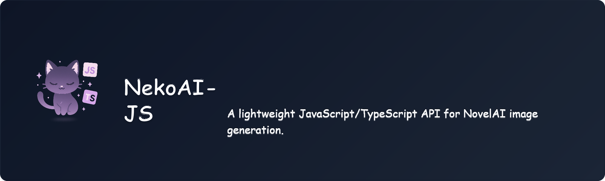

# NekoAI-JS

<div align="center">
  
  <p>A lightweight JavaScript/TypeScript client for the NovelAI API: image generation, Director tools, and text generation.</p>

  <div>
    <a href="https://github.com/Nya-Foundation/NekoAI-JS/blob/main/LICENSE"></a>
    <a href="https://github.com/Nya-Foundation/NekoAI-JS/actions/workflows/release.yml"></a>
    <a href="https://www.npmjs.com/package/nekoai-js"></a>
    <a href="https://deepwiki.com/Nya-Foundation/NekoAI-JS"></a>
  </div>
</div>

## Overview

NekoAI-JS wraps NovelAI's image and text generation APIs behind a small, strongly typed interface. It runs in both Node.js and browsers, ships CJS and ESM builds with full TypeScript definitions, and is based on the [NekoAI-API](https://github.com/Nya-Foundation/NekoAI-API) Python package.

**Capabilities**

- Image generation with V3, V4, and V4.5 models, including multi-character prompts, img2img, and inpainting
- Real-time streaming of V4/V4.5 generation steps
- Vibe transfer and character reference (director reference) for V4.5
- Dedicated 2x/4x upscaling and img2img-based enhancement
- All Director tools: line art, sketch, background removal, declutter, colorize, emotion change
- Text generation (chat and completions) through NovelAI's OpenAI-compatible endpoints, with streaming
- Tag autocomplete suggestions
- Metadata extraction from AI-generated images (PNG text chunks, EXIF, NovelAI stealth LSB)
- Automatic retries with exponential backoff, structured API errors, flexible image inputs

## Requirements

- Node.js 18 or later, or a modern browser
- A NovelAI account with an active subscription and a [persistent API token](https://docs.novelai.net/)

## Installation

```sh
npm install nekoai-js
# or: yarn add nekoai-js / pnpm add nekoai-js / bun add nekoai-js
```

In Node.js, install the optional `canvas` package if you plan to pass images by file path or buffer (img2img, inpainting, director tools, metadata extraction):

```sh
npm install canvas
```

Browsers use the native Canvas API and do not need this dependency.

## Quick Start

```ts
import { NovelAI, Model, Resolution } from "nekoai-js";

const client = new NovelAI({ token: process.env.NOVELAI_TOKEN });

const images = await client.generateImage({
  prompt: "1girl, cute, anime style, detailed",
  model: Model.V4_5,
  resPreset: Resolution.NORMAL_PORTRAIT,
});

await images[0].save("./output"); // Node.js
// or, in the browser:
// imgElement.src = images[0].toDataURL();
```

The package is dual-published: `import { NovelAI } from "nekoai-js"` (ESM) and `const { NovelAI } = require("nekoai-js")` (CJS) both work.

## Client Configuration

```ts
const client = new NovelAI({
  token: "your_access_token", // required
  host: Host.WEB,             // image API host (default: https://image.novelai.net)
  textHost: Host.TEXT,        // text API host (default: https://text.novelai.net)
  timeout: 120000,            // ms until the API responds, including generation time
  retry: {
    enabled: true,            // default: true
    maxRetries: 3,            // default: 3
    baseDelay: 1000,          // exponential backoff base, ms
    maxDelay: 30000,          // backoff cap, ms
    retryStatusCodes: [429, 500, 502, 503, 504],
  },
  verbose: false,             // log payloads and estimated Anlas cost
});
```

## Image Generation

`generateImage(metadata)` accepts a `Metadata` object. Every field is optional except `prompt` in practice; unset fields receive the same defaults the NovelAI web UI uses (model `V4_5`, 28 steps, scale 6.0, Euler Ancestral sampler, quality tags and negative-prompt preset applied).

```ts
const images = await client.generateImage({
  prompt: "1girl, cute, anime style",
  model: Model.V4_5,
  resPreset: Resolution.NORMAL_PORTRAIT,
  n_samples: 1,
  steps: 28,
  scale: 6.0,
  seed: 1234567890,     // omit for a random seed
  qualityToggle: true,  // append model-specific quality tags
  ucPreset: 0,          // negative-prompt preset strength (0-3, model dependent)
});
```

### Models

| Enum                  | API id                              |
| --------------------- | ----------------------------------- |
| `Model.V5`            | `nai-diffusion-5-full`              |
| `Model.V5_MEDIUM`     | `nai-diffusion-5-full-medium`       |
| `Model.V5_INP`        | `nai-diffusion-5-full-inpainting`   |
| `Model.V5_MEDIUM_INP` | `nai-diffusion-5-full-medium-inpainting` |
| `Model.V5_CUR`        | `nai-diffusion-5-curated`           |
| `Model.V4_5`          | `nai-diffusion-4-5-full`            |
| `Model.V4_5_INP`      | `nai-diffusion-4-5-full-inpainting` |
| `Model.V4_5_CUR`      | `nai-diffusion-4-5-curated`         |
| `Model.V4_5_CUR_INP`  | `nai-diffusion-4-5-curated-inpainting` |
| `Model.V4`            | `nai-diffusion-4-full`              |
| `Model.V4_INP`        | `nai-diffusion-4-full-inpainting`   |
| `Model.V4_CUR`        | `nai-diffusion-4-curated-preview`   |
| `Model.V4_CUR_INP`    | `nai-diffusion-4-curated-inpainting` |
| `Model.V3`            | `nai-diffusion-3`                   |
| `Model.V3_INP`        | `nai-diffusion-3-inpainting`        |
| `Model.FURRY`         | `nai-diffusion-furry-3`             |
| `Model.FURRY_INP`     | `nai-diffusion-furry-3-inpainting`  |

V5 uses the streaming image endpoint and `params_version: 4`. Select a V5 model explicitly; the library default remains V4.5. V5 Full and Curated default to 32 steps and guidance 7. At normal resolution, 32 steps exceed the Opus 28 step allowance and use Anlas. Medium effort is fixed at 14 steps and Euler Ancestral. Medium effort rejects custom steps, sampler, undesired content, and guidance rescale. V5 requests PNG by default. Set `image_format: "webp"` to request WebP. Vibe transfer and director references are not available with V5. For V5 Curated inpainting, use `Model.V4_5_CUR_INP` until its V5 model is available.

```ts
const images = await client.generateImage({ prompt: "1girl, garden", model: Model.V5 });
```

### Resolution presets

`resPreset` sets `width`/`height` unless you specify them explicitly. Explicit dimensions are rounded up to multiples of 64 and validated against the API's pixel budget.

| Preset                          | Dimensions  |
| ------------------------------- | ----------- |
| `SMALL_PORTRAIT` / `SMALL_LANDSCAPE` / `SMALL_SQUARE` | 512x768 / 768x512 / 640x640 |
| `NORMAL_PORTRAIT` / `NORMAL_LANDSCAPE` / `NORMAL_SQUARE` | 832x1216 / 1216x832 / 1024x1024 |
| `LARGE_PORTRAIT` / `LARGE_LANDSCAPE` / `LARGE_SQUARE` | 1024x1536 / 1536x1024 / 1472x1472 |
| `WALLPAPER_PORTRAIT` / `WALLPAPER_LANDSCAPE` | 1088x1920 / 1920x1088 |

### Streaming

V4/V4.5 generations can stream each denoising step. Pass `true` as the second argument; the return type narrows to an async generator of `MsgpackEvent` objects.

```ts
import { EventType } from "nekoai-js";

const stream = await client.generateImage(
  { prompt: "1girl, night sky", model: Model.V4_5 },
  true,
);

for await (const event of stream) {
  if (event.event_type === EventType.INTERMEDIATE) {
    console.log(`step ${event.step_ix}`); // event.image is a JPEG preview
  } else if (event.event_type === EventType.FINAL) {
    await event.image.save("./output/final.png");
  }
}
```

Streaming with a V3 model throws, since V3 only returns final images.

### Image inputs

Every image-bearing field (`image`, `mask`, `reference_image_multiple`, `director_reference_images`, and all director tool / upscale / enhance arguments) accepts any of:

- file path (Node.js)
- HTTP(S) URL, data URL, or blob URL
- raw base64 string
- `Blob`, `File`, `ArrayBuffer`, `Uint8Array`
- `HTMLImageElement`, `HTMLCanvasElement` (browser)
- `{ data: Uint8Array }` (for example, a generated `Image` object)

Conversion happens automatically; you no longer need to call `parseImage` yourself (it remains exported for cases where you need dimensions).

### img2img

```ts
import { Action } from "nekoai-js";

const images = await client.generateImage({
  prompt: "1girl, fantasy outfit",
  action: Action.IMG2IMG,
  image: "./input/image.png",
  strength: 0.5, // lower = closer to the source
  noise: 0.1,
});
```

### Inpainting

Use an inpainting model with `Action.INPAINT`. White mask areas are regenerated.

```ts
const images = await client.generateImage({
  prompt: "1girl, red eyes",
  model: Model.V4_5_INP,
  action: Action.INPAINT,
  image: "./input/image.png",
  mask: "./input/mask.png",
  add_original_image: true, // preserve unmasked areas exactly
});
```

### Multi-character prompts (V4/V4.5)

```ts
const images = await client.generateImage({
  prompt: "two people standing together, park background",
  model: Model.V4_5,
  characterPrompts: [
    {
      prompt: "girl, red hair, red dress",
      uc: "bad hands, bad anatomy",
      center: { x: 0.3, y: 0.5 }, // optional; coordinates in 0-1
    },
    {
      prompt: "boy, blue hair, blue uniform",
      center: { x: 0.7, y: 0.5 },
    },
  ],
});
```

Character coordinates are only sent when at least one character has a non-default center. The V4 prompt structures (`v4_prompt`, `v4_negative_prompt`) are built automatically.

### Vibe transfer (V4/V4.5)

Reference images are encoded into vibe tokens through `/ai/encode-vibe` (results are cached in-memory per client, keyed by image hash, extraction level, and model).

```ts
const images = await client.generateImage({
  prompt: "1girl, cute",
  model: Model.V4_5,
  reference_image_multiple: ["./input/reference.png"],
  reference_information_extracted_multiple: [0.7], // 0-1, default 1.0
  reference_strength_multiple: [0.6],              // 0-1, default 0.6
});
```

### Character reference (V4.5)

Director reference conditions the generation on a reference character and/or style. Reference images should be 1024x1536, 1536x1024, or 1472x1472, padded with black to fit.

```ts
const images = await client.generateImage({
  prompt: "1girl, dancing in the rain",
  model: Model.V4_5,
  director_reference_images: ["./reference/character.png"],
  director_reference_descriptions: [
    { caption: { base_caption: "character&style", char_captions: [] } },
  ],
  director_reference_information_extracted: [1],
  director_reference_strength_values: [1],
  director_reference_secondary_strength_values: [1], // fidelity, 0-1
});
```

Use `base_caption: "character"` to transfer only the character, or `"character&style"` to transfer the art style as well.

### Upscale and enhance

```ts
// Dedicated upscaler (api.novelai.net); pixels preserved, no re-generation
const upscaled = await client.upscale("./output/image.png", 2); // scale: 2 or 4
await upscaled.save("./output/upscaled.png");

// Enhance: img2img re-generation at a scaled-up resolution
const enhanced = await client.enhance("./output/image.png", {
  prompt: "1girl, cute, watercolor", // ideally the image's original prompt
  upscaleFactor: 1.5,                // clamped to the API's pixel budget
  strength: 0.4,                     // lower = closer to the source
});
await enhanced[0].save("./output/enhanced.png");
```

## Director Tools

Each tool takes any supported image input and returns a single `Image`.

```ts
const lineArt = await client.lineArt("./input/image.png");
const sketch = await client.sketch("./input/image.png");
const noBackground = await client.backgroundRemoval("./input/image.png");
const decluttered = await client.declutter("./input/image.png");
const colorized = await client.colorize("./input/lineart.png", "blue hair", 0);

import { EmotionOptions, EmotionLevel } from "nekoai-js";
const happy = await client.changeEmotion(
  "./input/image.png",
  EmotionOptions.HAPPY,
  "",                  // additional prompt
  EmotionLevel.NORMAL, // strength of the change
);
```

## Tag Suggestions

```ts
const suggestions = await client.suggestTags("blue hai");
// [{ tag: "blue hair", confidence: ..., count: ... }, ...]
```

An optional second argument selects the model (`Model.V4_5` by default) and a third the query language (`"en"` or `"jp"`).

## Text Generation

Text generation uses NovelAI's OpenAI-compatible endpoints on `text.novelai.net`. Query the live model list with `listTextModels()`; the `TextModel` enum covers the currently available ids (`glm-4-6`, `xialong-v1`).

```ts
import { TextModel } from "nekoai-js";

const models = await client.listTextModels();

// Chat completion; a plain string becomes a single user message
const completion = await client.chat("Describe a cozy tavern in one sentence.", {
  model: TextModel.GLM_4_6, // default
  max_tokens: 100,
  temperature: 1.0,
});
console.log(completion.choices[0].message.content);

// Message arrays with roles
const reply = await client.chat(
  [
    { role: "system", content: "You are a concise storyteller." },
    { role: "user", content: "Continue: The dragon opened one eye and" },
  ],
  { max_tokens: 100 },
);

// Streaming
const stream = await client.chatStream("Tell me a short story.", { max_tokens: 200 });
for await (const chunk of stream) {
  const delta = chunk.choices[0]?.delta?.content;
  if (delta) process.stdout.write(delta);
}

// Raw text completion
const continuation = await client.completion("The old lighthouse keeper", {
  max_tokens: 100,
});
console.log(continuation.choices[0].text);
```

Options follow the OpenAI parameter names (`max_tokens`, `temperature`, `top_p`, `top_k`, `min_p`, `frequency_penalty`, `presence_penalty`, `stop`, `seed`, `logit_bias`, `n`); unknown keys are passed through to the API unchanged.

## Working with Results

Generation methods return `Image` objects:

| Member | Description |
| ------ | ----------- |
| `image.data` | Raw bytes (`Uint8Array`) |
| `image.filename` | Timestamped default filename |
| `image.size` | Size in bytes |
| `await image.save(path)` | Write to disk (Node.js). Directories are created as needed; a trailing `/` or extension-less path is treated as a directory |
| `image.toBase64()` | Base64 string |
| `image.toDataURL()` | `data:` URL for direct use in `img.src` |
| `image.toBlob()` / `image.toFile()` | Browser `Blob` / `File` |

## Metadata Extraction

Read generation parameters back out of AI-generated images. Supports NovelAI PNG text chunks, NovelAI stealth metadata (alpha-channel LSB), and Stable Diffusion WebUI EXIF/parameters formats.

```ts
import { extractImageMetadata, getImageSummary } from "nekoai-js";

const metadata = await extractImageMetadata("./image.png");
// { type: "NOVELAI" | "SD-WEBUI" | "NONE", entries: [{ keyword, text }, ...] }

const summary = await getImageSummary("./image.png");
// { dimensions, generationTool, positivePrompt, parameters, ... }
```

## Error Handling

API failures throw `NovelAIApiError`, which carries the HTTP status and the error message returned by the API:

```ts
import { NovelAIApiError } from "nekoai-js";

try {
  await client.generateImage({ prompt: "1girl" });
} catch (err) {
  if (err instanceof NovelAIApiError) {
    console.error(err.status, err.message); // e.g. 402 "Not enough Anlas"
  }
}
```

Retryable failures (rate limits, 5xx responses, network errors, timeouts) are retried automatically with exponential backoff and jitter according to the client's `retry` configuration. Set `retry: { enabled: false }` to disable.

## Method Reference

| Method | Description |
| ------ | ----------- |
| `generateImage(metadata, stream?, isOpus?)` | Generate images; `stream: true` returns an async generator of step events |
| `enhance(image, options?)` | img2img re-generation at a scaled-up resolution |
| `upscale(image, scale?)` | Dedicated 2x/4x upscaler |
| `lineArt(image)` / `sketch(image)` / `backgroundRemoval(image)` / `declutter(image)` | Director tools |
| `colorize(image, prompt?, defry?)` | Colorize sketch or line art |
| `changeEmotion(image, emotion?, prompt?, level?)` | Change a character's emotion |
| `suggestTags(prompt, model?, lang?)` | Tag autocomplete |
| `chat(messages, options?)` | Chat completion (OpenAI format) |
| `chatStream(messages, options?)` | Streaming chat completion |
| `completion(prompt, options?)` | Raw text completion |
| `listTextModels()` | Available text model ids |
| `useDirectorTool(request)` | Low-level director tool access |

## Browser Usage

The library works in browsers without extra dependencies; image parsing uses the DOM Canvas API. Note that calling the NovelAI API directly from a browser is subject to CORS policy, and embedding a user's token in client-side code should be handled with care. For user-facing applications, NovelAI recommends asking each user for their own persistent API token.

```html
<script type="module">
  import { NovelAI, Model } from "./node_modules/nekoai-js/dist/index.mjs";

  const client = new NovelAI({ token });
  const images = await client.generateImage({ prompt: "1girl", model: Model.V4_5 });
  document.querySelector("img").src = images[0].toDataURL();
</script>
```

## Development

```sh
npm install
npm run typecheck  # tsc --noEmit
npm test           # vitest (offline unit tests)
npm run lint       # eslint
npm run build      # tsup -> dist/ (CJS + ESM + d.ts)
```

Examples in `examples/` run against the live API and expect a `NOVELAI_TOKEN` entry in `.env`.

## License

Licensed under [AGPL-3.0](LICENSE).

This project transitioned from MIT to AGPL-3.0 to align with its inspiration source, [NekoAI-API](https://github.com/Nya-Foundation/NekoAI-API), and to provide stronger copyleft protections for the community.

## References

- [NovelAI Documentation](https://docs.novelai.net/)
- [NovelAI Image API](https://image.novelai.net/docs/index.html)
- [NovelAI Text API](https://text.novelai.net/docs/index.html)
- [NovelAI Backend API](https://api.novelai.net/docs)
- [NovelAI Unofficial Knowledgebase](https://naidb.miraheze.org/wiki/Using_the_API)
- [NekoAI-API (Python)](https://github.com/Nya-Foundation/NekoAI-API)
